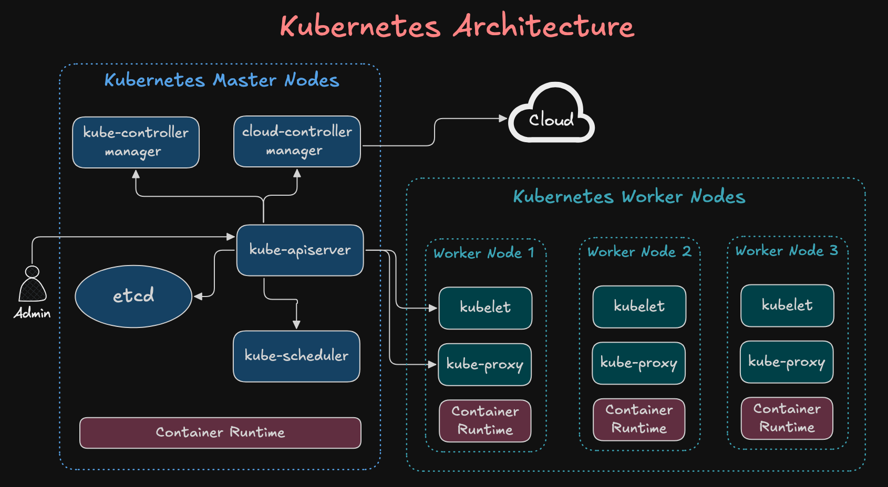
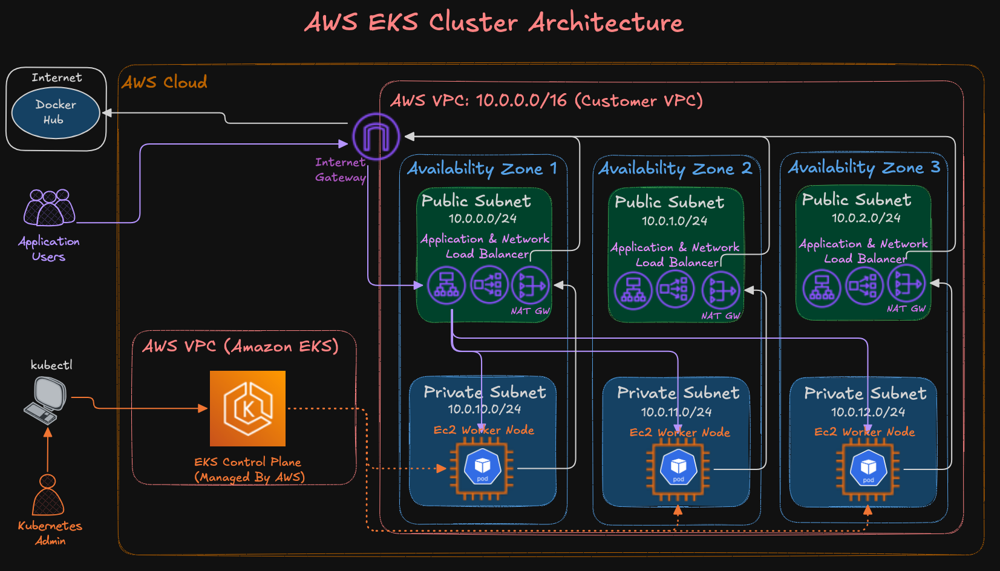
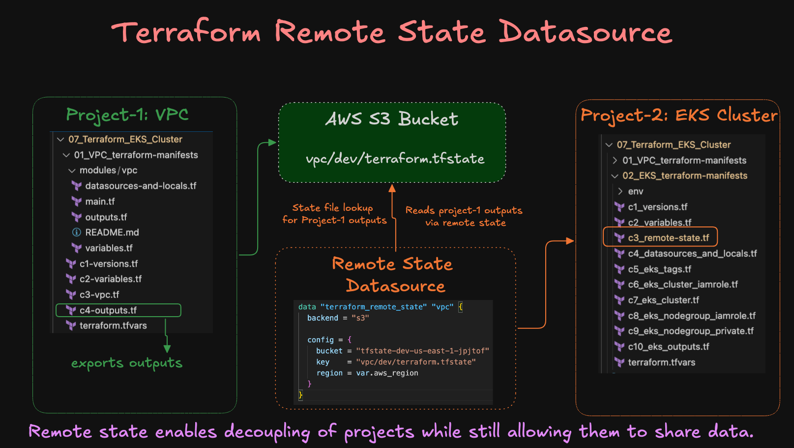

# AWS EKS Cluster Creation with Terraform

This project provisions a **production-ready Amazon EKS cluster** using Terraform.  
We build the cluster step by step, covering IAM roles, networking, node groups, and outputs.

---

## Kubernetes Architecture


---

## AWS EKS Cluster Architecture


---

## Terraform Remote State Datasource for VPC and EKS Cluster Terraform Projects 
- Sharing data across Terraform projects


---

## Step-01: Project Structure

### 01_VPC_terraform-manifests
| File | Description |
|------|-------------|
| `c1-versions.tf` | Required Terraform + AWS provider versions |
| `c2-variables.tf` | Input variables (region, CIDR, etc.) |
| `c3-vpc.tf` | VPC resource definition |
| `c4-outputs.tf` | VPC outputs (subnet IDs, VPC ID) |

### 02_EKS_terraform-manifests
| File | Description |
|------|-------------|
| `c1_versions.tf` | Required Terraform + AWS provider versions |
| `c2_variables.tf` | Input variables (region, cluster name, etc.) |
| `c3_remote-state.tf` | Remote backend for Terraform state (S3 + DynamoDB) |
| `c4_datasources_and_locals.tf` | AWS data sources and local values |
| `c5_eks_tags.tf` | Common tags for resources |
| `c6_eks_cluster_iamrole.tf` | IAM role for EKS control plane |
| `c7_eks_cluster.tf` | EKS cluster resource definition |
| `c8_eks_nodegroup_iamrole.tf` | IAM role for EKS worker node groups |
| `c9_eks_nodegroup_private.tf` | Private node group configuration |
| `c10_eks_outputs.tf` | Useful Terraform outputs (kubeconfig, cluster details) |

### 03_ECR_terraform-manifests
| File | Description |
|------|-------------|
| `c1_ecr_repositories.tf` | ECR repositories for microservices (ui, cart, catalog, orders, checkout, users) |
| `c2_variables.tf` | Input variables (region, environment) |
| `c3_outputs.tf` | ECR repository URLs and ARNs |

### 04_RDS_terraform-manifests
| File | Description |
|------|-------------|
| `c1_versions.tf` | Required Terraform + AWS provider versions |
| `c2_variables.tf` | Input variables (instance class, engine, credentials) |
| `c3_remote-state.tf` | Remote state data sources from VPC and EKS |
| `c3_rds.tf` | RDS PostgreSQL instance with security groups |
| `c4_outputs.tf` | RDS endpoint, ARN, and connection details |

### 05_S3_terraform-manifests
| File | Description |
|------|-------------|
| `c1_versions.tf` | Required Terraform + AWS provider versions |
| `c2_variables.tf` | Input variables (region, environment) |
| `c3_remote_state.tf` | Remote state data sources from VPC and EKS |
| `c3_s3.tf` | S3 buckets for assets and logs with lifecycle policies |
| `c4_outputs.tf` | S3 bucket names and ARNs |

### 06_ElastiCache_terraform-manifests
| File | Description |
|------|-------------|
| `c1_versions.tf` | Required Terraform + AWS provider versions |
| `c2_variables.tf` | Input variables (node type, engine version) |
| `c3_remote_state.tf` | Remote state data sources from VPC and EKS |
| `c3_redis.tf` | ElastiCache Redis cluster with security groups |
| `c4_outputs.tf` | Redis endpoint, port, and auth token |

### 07_ALB_terraform-manifests
| File | Description |
|------|-------------|
| `c1_versions.tf` | Required Terraform + AWS provider versions |
| `c2_variables.tf` | Input variables (certificate ARN optional) |
| `c3_remote_state.tf` | Remote state data sources from VPC and EKS |
| `c3_alb.tf` | Application Load Balancer with target groups |
| `c4_outputs.tf` | ALB DNS name, ARN, and target group ARNs |

---

## Step-02: Steps to Provision

### Deployment Order
1. **VPC** - Deploy first to create network infrastructure
2. **EKS** - Deploy second to create Kubernetes cluster
3. **ECR** - Deploy third to create container registry
4. **RDS** - Deploy fourth to create database
5. **S3** - Deploy fifth to create storage buckets
6. **ElastiCache** - Deploy sixth to create Redis cache
7. **ALB** - Deploy last to create load balancer

### Commands (run in each directory in order)
```bash
# Terraform Initialize
terraform init

# Terraform Validate
terraform validate

# Terraform Plan
terraform plan

# Terraform Apply
terraform apply -auto-approve
```

---

## Step-03: Configure kubectl cli to access EKS cluster
```bash
# EKS kubeconfig
aws eks update-kubeconfig --name <cluster_name> --region <aws_region>

# List Kubernetes Nodes
kubectl get nodes

# List Kubernetes Pods 
kubectl get pods -n kube-system
```

## Step-04: Browse EKS Cluster features on AWS Console
- Go to AWS Console -> EKS
- Review Tabs
  - Overview
  - Resources
  - Compute
  - Networking
  - Add-ons
  - Access
  - Observability
  - Update history
  - Tags

---

## Step-05: Required Variables

### RDS Database (04_RDS_terraform-manifests)
You must provide the following variables via `terraform.tfvars` or command line:
- `db_username` - Database master username
- `db_password` - Database master password

Example:
```bash
terraform apply -var="db_username=admin" -var="db_password=SecurePassword123!"
```

### ALB (07_ALB_terraform-manifests)
Optional variable:
- `certificate_arn` - ACM certificate ARN for HTTPS (if not provided, HTTP only)

---

## Infrastructure Components

### ECR Repositories
- retail-store/ui
- retail-store/cart
- retail-store/catalog
- retail-store/orders
- retail-store/checkout
- retail-store/users (NEW)

### AWS Services
- **RDS PostgreSQL** - Database for application data
- **S3 Buckets** - Storage for assets and logs
- **ElastiCache Redis** - Caching layer
- **Application Load Balancer** - Traffic distribution

### EKS Cluster
- **Kubernetes Version**: 1.30 (updated from null)
- **Node Instance Type**: t3.large (updated from t3.medium)
- **Node Capacity**: ON_DEMAND
- **Node Disk Size**: 20GB
- **Scaling**: 1-6 nodes (desired: 3)

---
